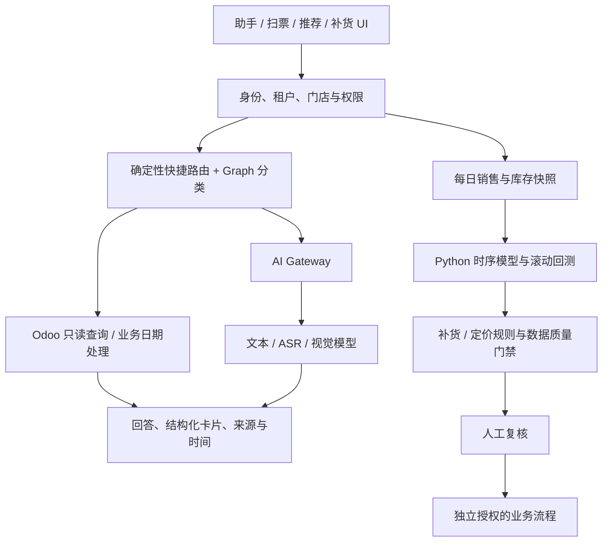

# AI 整体设计

更新日期：2026-11-03；基线为本库 baseline.md 中的主分支快照。线上有效模型与开关需从受控环境确认，本轮未读取密钥或修改配置。

## 按职责拆分

助手查数并非让模型自由查询生产库。ClassifyQueryNode、WorkflowRouteRouter 等优先处理确定性路径；OdooReportQueryNode 查询受控数据源，ReportRespondNode 返回结果。Graph 中的遗留 SQL 相关节点不意味着允许在 Odoo 门店任意执行模型 SQL。

预测采用 seasonal-naive、moving-average、exponential-smoothing、Croston SBA、TSB、two-stage occurrence 等候选，按商品/分群及训练前缀选择；LLM 解释不替代数量模型。

## 数据和接口

- 助手：POST /api/ai/assistant；语音：POST /api/ai/transcribe；历史：GET /api/ai/threads 和详情。
- 识别：POST /api/ai/invoice/preview；侍酒：/api/ai/sommelier 下的推荐、问答、酒标识别。
- 决策：/api/ai/decisions 下的预览、反馈和回测；/api/ai/forecast 下的 sales / risks。POST 方法本身不说明是否业务写入，需看具体执行路径。
- Next BFF 提供 /api/odoo/replenishment、/api/odoo/price-suggestions、/api/odoo/dead-stock 等入口。
- 指令草稿 /api/ai/commands 与发票 session 会持久化应用元数据；不等同于 Odoo 采购、价格或库存已经变更。

数据链路、内部 forecast-service 接口和回测前置条件详见[预测实现](../../../AI_FORECASTING_IMPLEMENTATION.md)与[评测工具说明](../../../../scripts/ai-eval/README.md)。

## 模型、可靠性和成本

Gateway 统一任务类型、模型选择、重试、配额及用量记录，业务层依赖 AiGateway。代码默认值见[AiGatewayProperties](../../../../pos-api/src/main/java/com/orithos/modules/ai/gateway/AiGatewayProperties.java)，配置可能覆盖默认值，不能据此宣称线上模型或费用。

分别测 P50/P95、成功率、429/5xx、fallback、token 和实际账单；应用估算 token 不等于 provider 计费。长耗时补货数据读取与 provider 推理必须分开统计。每轮记录 model、prompt/config 版本、数据时间及 runtime SHA，目前多份历史证据缺少这些元数据。

## 安全和故障

服务端锁定 tenant/company/outlet/warehouse；模型不能提供这些控制参数。AI_ENABLED=false 按 fail-closed 处理；数据源不可用返回不可用，不用零需求或 Classic 目录兜底。错误和日志需脱敏。

读数、草稿、确认、收货是不同流程。OCR 预览不收货，建议不自动改价，预测不自动采购；任何写入需权限、人工确认、幂等与回读对账。业务只读可以产生会话、用量、审计或评测元数据，报告必须准确说明。

## 设计依据

[生产化基础](../../../AI_PRODUCTION_FOUNDATION.md)是历史基础设计，接入顺序不能当成最新完成清单；[生产开通](../../../AI_PRODUCTION_ENABLEMENT.md)是运行前检查。最新源码路径和证据映射见各子功能 design / validation。
