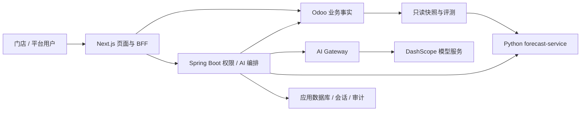

# 产品与系统总览

更新日期：2026-11-03。代码基线见[基线说明](baseline.md)；负责人与产品 KPI 基线待项目 owner 指定。

## 目标与用户

面向澳洲酒类与精品零售，服务收银员、店长、采购人员和平台运营人员。核心目标是完成可信的销售、库存、采购与报表闭环；AI 负责降低查询、识别和决策准备成本。

## 系统边界

业务事实与 AI 建议分开：Odoo 保存业务账本，应用保存身份、会话、建议及审计，预测快照不覆盖实时库存。Classic 遗留路径不能作为 Odoo 门店的第二写入源。具体契约以[功能边界](../PRODUCT_BOUNDARIES.md)和[Odoo 集成契约](../ODOO_INTEGRATION_CONTRACT.md)为准。

`app.*` 是平台控制平面；`demo.*`、`skr.*` 是门店面。共享 `aipos_uat` 的试用记录不证明生产租户数据库隔离。公司、门店、仓库范围由服务端身份决定。

## 项目当前判断

已具备多模块源码与历史测试记录；这不等于所有模块在同一版本完成验收。首期事实库完整盘点 AI，其他业务模块保留待盘点状态。库存、成本和交期质量会同时影响报表可信度及 AI 建议，不能靠更换模型弥补。

营业日按门店/Odoo 公司时区切分；文档维护日期使用 Asia/Shanghai。滚动 24 小时不等于门店“今天”。

## 成效口径

分别记录三类结果：功能可用性（入口和契约）、决策质量（准确率/误差/安全）、经营结果（节省工时/毛利/库存改善）。目前缺少可归因的经营收益基线和对照试验；不发布“已节省金额”“已提升毛利”的结论。
